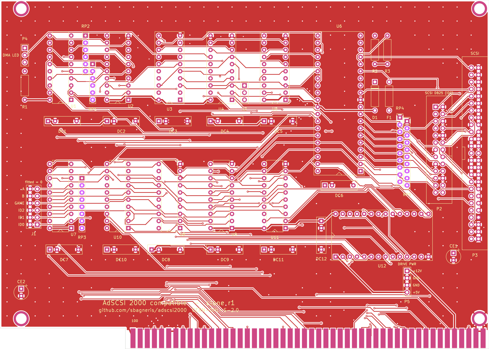

# ICD AdSCSI 2000 (Advantage 2000) - hardware preservation

The ICD AdSCSI 2000 (silkscreen "ADVANTAGE 2000", 1990) is a Zorro II SCSI controller for the Amiga 2000. Its
three GAL16V8 chips are read-protected and, like many programmable logic parts of that era, are reaching the end
of their data retention. This repository preserves the card: what each GAL does, the complete circuit, and the
measurements behind both, so the card can be repaired, understood and rebuilt.

## What is here

| Path | Contents |
|---|---|
| `docs/hardware.md` | How the card works: Autoconfig, address map, registers, what each GAL does, jumpers, connectors |
| `gals/u3`, `gals/u4`, `gals/u5` | Per-GAL characterisation data and the recovered logic (see below) |
| `gals/uN/uN_named.pld` / `.jed` | GALasm source with board signal names, and the JEDEC file to program a replacement |
| `schematic/kicad/` | KiCad 10 project: root sheet + 6 sheets, project symbol and footprint libraries, `adscsi2000.pdf`, and the clone PCB (`adscsi2000.kicad_pcb`) |
| `schematic/kicad/fab/` | Ready-to-order clone PCB: gerbers + drill files (`adscsi2000_gerbers.zip`), BOM, previews, `ORDER_NOTES.txt` |
| `schematic/netlist/merged.csv` | The measured netlist: 116 nets, 518 pins |
| `schematic/continuity/` | The raw continuity sweeps the netlist was built from |
| `schematic/tools/` | Photo registration, netlist merging, the netlist-to-KiCad schematic generator and the PCB pipeline |
| `inputs/closeups*/`, `inputs/mycard_*` | Photos of the measured card (both sides, close-up tiles, GAL footprints without sockets) |

## How the GALs were recovered

The originals are secured, so their fuse maps cannot be read. Each chip was characterised in a DuPAL V3
("dupico") board, read-only:

1. A first look classified pins (inputs, driven outputs, tri-stated outputs) and a second read in a different
   input order showed that all three GALs hold state (latches built from output feedback; U4 also uses registers).
2. Each chip's behaviour was mapped exhaustively one input change at a time (and one clock pulse at a time for the
   registered U4): every reachable state and every move from it (`gals/uN/uN_moves*.tsv`), with replays and
   re-clocking to rule out measurement errors.
3. Equations were fitted with espresso and refined until every recorded move (U3 79,824, U4 70,880, U5 12,080)
   replays exactly with outputs allowed to settle in any order (`gals/uN/uN_fit.txt`).
4. GALasm sources were generated and the resulting fuse maps were replayed against the recordings again.

These are **equivalent** equations: they reproduce everything the original can do in circuit, but the secured
originals' exact product terms are unknowable. Combinations the circuit can never reach were don't-cares.

The tools are in the companion repository
[gal-dupico-re](https://github.com/sbagneris/gal-dupico-re).

## The clone PCB

A 1:1 through-hole clone of the card, made to validate this work in a real Amiga 2000:

- **Same parts, same places.** Every footprint was fitted to the pin positions measured on the original (scan
  calibrated so all 41 parts land on the original's 0.025" grid), with the outline, mounting holes and finger tab from
  caliper measurements and the Zorro mechanical spec (finger tab 129.26 mm).
- **Same circuit.** The PCB is generated from the measured netlist; KiCad's schematic-parity check is clean.
- **Better ground than the original.** The original has no ground pour; the clone has GND pours on both layers tied
  together by a stitching-via grid every 5 mm, which should help on noisy Zorro buses (68040 accelerators are known to
  trouble the original).
- Two layers, 1.6 mm, signals autorouted (Freerouting) and checked: DRC clean, every documented exception listed in
  `schematic/kicad/drc_accepted.tsv` with its reason.

To order: upload `schematic/kicad/fab/adscsi2000_gerbers.zip` and follow `ORDER_NOTES.txt` (gold fingers with a
bevelled edge). Component values are in the BOM (`adscsi2000_bom.csv`). The three GALs are programmed from
`gals/uN/uN_named.jed` (security fuse off); the boot ROM is not included (see below).

The whole board is reproducible from the scripts in `schematic/tools/`: `pcb_route.sh` (generate + autoroute) then
`pcb_finish.sh` (pours, ground stitching, hand edits replayed, labels, DRC exclusions) and `pcb_fab.sh` (fab outputs).

**Status: not yet built or tested.** The first boards are the test of everything in this repository.

## Status

- GAL logic recovered and named (fuse maps verified in simulation; programming and testing replacement chips is next).
- Netlist complete and confirmed by continuity on a real card; KiCad schematic generated from it: the exported
  netlist matches the measurements on all 116 nets, ERC clean.
- Clone PCB designed and ready to order (above); next: build and test it, then a compact SMD version.

## Not included

The boot ROM image and ICD's software are copyrighted by ICD Inc. and are not distributed here. Neither are the
third-party reference photos used early on.

## Licences

- Hardware design (`schematic/kicad/`: schematic, PCB, footprints and fabrication files): CERN-OHL-S-2.0
- Software (`schematic/tools/`, scripts): BSD-3-Clause
- Documentation, measurement data, recovered GAL equations and JEDEC files, photos: CC BY-SA 4.0

See `LICENSE.md` and `LICENSES/`. "ICD", "AdSCSI" and "Advantage 2000" are names of their respective owners; this
is an independent preservation project.

## Credits

Measurements, photos and bench work: Stephane Bagneris. Analysis and tooling written with Claude (Anthropic).
DuPAL by the [DuPAL-PAL-DUmper](https://github.com/DuPAL-PAL-DUmper) project. Zorro II pinout from the Amiga
Hardware Reference Manual; 5380 pinout from the NCR 5380 SCSI Interface Chip Design Manual.
